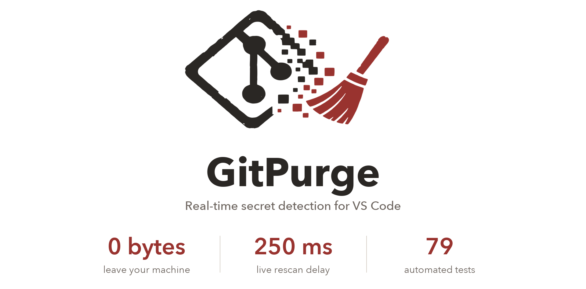
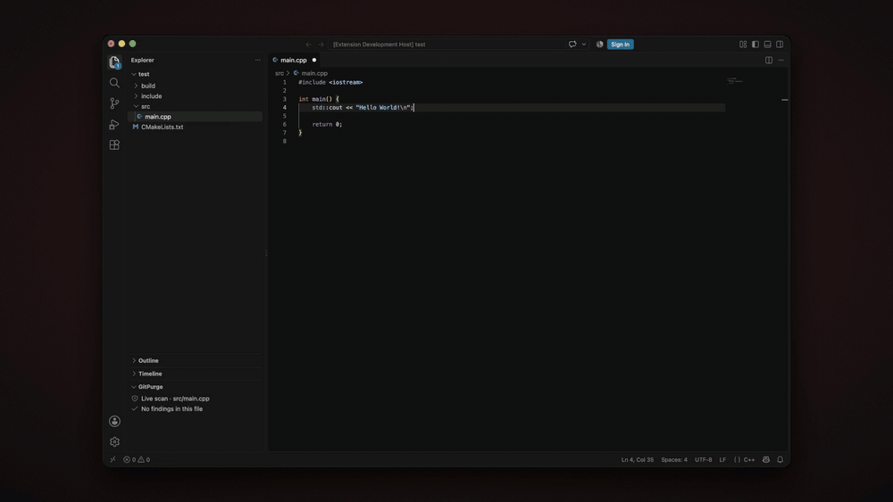

<p align="center">
  <picture>
    <source media="(prefers-color-scheme: dark)" srcset="assets/banner-dark.png">
    
  </picture>
</p>

GitPurge is a VS Code extension that flags API keys, tokens, and credentials while you type, before they end up in a commit.

[](https://marketplace.visualstudio.com/items?itemName=Chetan-boi.gitpurge-vscode)
[](LICENSE)



## What it does

GitPurge scans the file you are editing and reports suspected secrets as editor diagnostics. Findings also appear in a dedicated GitPurge view in the activity bar, where you can jump to each one.

Detection combines two approaches:

- **Known patterns.** AWS keys, GitHub, Slack, Stripe, Google, OpenAI, Anthropic, SendGrid and Discord tokens, private key headers, and PostgreSQL, MySQL and MongoDB connection strings with credentials.
- **Assignments.** Long values assigned to names like `api_key`, `secret`, `token`, or `password` (including prefixed names such as `client_secret`). References like `process.env.X` are ignored.
- **Entropy.** Long random-looking strings on lines that mention a secret-like name are scored with Shannon entropy.

Workspace scans use `git ls-files`, so ignored files are skipped.

Everything runs locally. Nothing in your code is sent anywhere.

## Install

Search for "GitPurge" in the Extensions view, or install it from the [Marketplace page](https://marketplace.visualstudio.com/items?itemName=Chetan-boi.gitpurge-vscode). VS Code 1.90 or later is required.

## Usage

Open the command palette (`Cmd+Shift+P` / `Ctrl+Shift+P`) and run:

| Command | Description |
| :--- | :--- |
| `GitPurge: Scan Active File` | Scan the file in the active editor |
| `GitPurge: Scan Workspace` | Scan every tracked file in the workspace |
| `GitPurge: Show Findings` | Pick a finding from a list and jump to it |
| `GitPurge: Show Output` | Open the extension's log |

The active file is also rescanned automatically as you edit.

## Settings

| Setting | Default | Description |
| :--- | :--- | :--- |
| `gitpurge.exclude` | `[]` | Glob patterns to skip during workspace scans |
| `gitpurge.maxFileSize` | `1048576` | Largest file size, in bytes, that will be scanned |

```json
{
  "gitpurge.exclude": ["**/node_modules/**", "**/dist/**"],
  "gitpurge.maxFileSize": 1048576
}
```

## Command line and pre-commit

The same project ships a Python CLI for terminals, CI, and git hooks. It needs Python 3.10 or later and has no dependencies.

```sh
pip install .                      # from a clone of this repository
gitpurge src/                      # scan files or directories
gitpurge --staged                  # scan what is about to be committed
cat config.env | gitpurge -        # scan stdin
gitpurge --format json --fail-on error app.py
```

Findings are printed as `path:line:column: severity [rule] message`, with the secret itself partly masked. The exit status is `0` when clean, `1` when something was found at or above `--fail-on` (default `warning`), and `2` for usage or git errors.

To block commits, add this to `.pre-commit-config.yaml`:

```yaml
repos:
  - repo: https://github.com/chetan-boi/GitPurge
    rev: main   # pin to a tag or commit once you have one
    hooks:
      - id: gitpurge
```

The CLI recognises more provider formats than the extension currently does: Slack, Stripe, Google, OpenAI, Anthropic, SendGrid, Discord, PostgreSQL, MySQL, and AWS secret keys, on top of the extension's own checks.

## Limitations

GitPurge is a heuristic scanner. It will miss some secrets and occasionally flag harmless strings. If a real secret has been committed, rotate it. Removing it from the working tree does not remove it from history.

## Development

```sh
npm install
npm test                      # TypeScript scanner tests (extension)
uv run --group dev pytest     # Python engine and CLI tests
```

```text
src/
  extension.ts    VS Code entry point, diagnostics, findings view
  scanner.ts      scanner used by the extension
  gitignore.ts    .gitignore matching
  gitpurge/       Python engine and CLI (detectors, entropy, cli)
test/             TypeScript and Python tests
```

## License

Apache 2.0. See [LICENSE](LICENSE).
